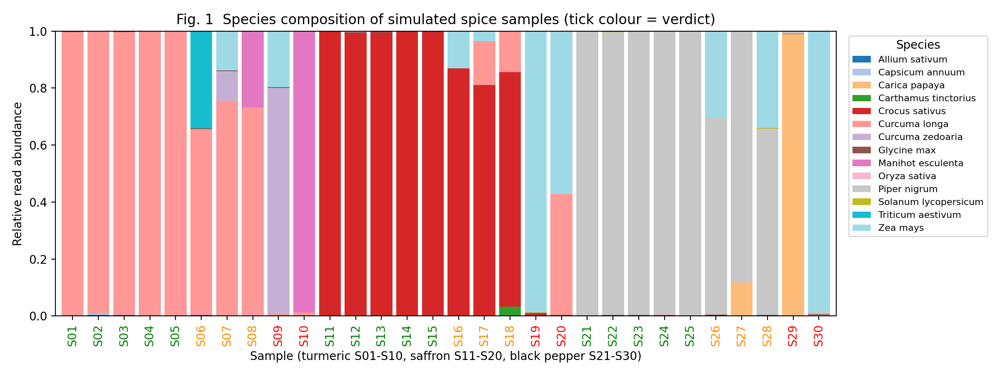
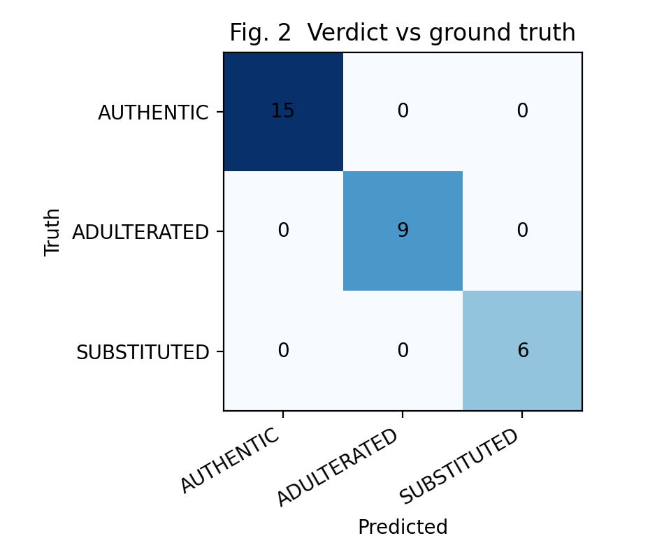
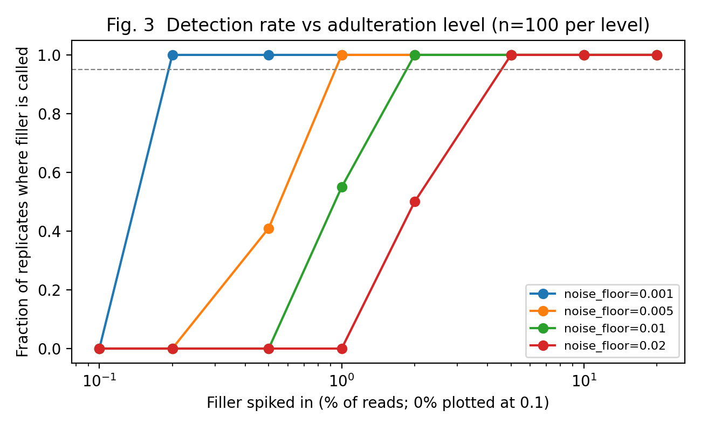

# DNA Detective: A Reproducible ITS2 Metabarcoding Workflow for Detecting Adulteration and Substitution in Spices and Herbal Products

**Author:** <YOUR NAME> · <Your institution / independent researcher> · <email>
**Repository:** https://github.com/<your-username>/dna-detective
**Status:** Pipeline validation on simulated data. Real-data validation is planned (see Future Work).

---

## Abstract

**Background.** Spices and herbal ingredients are frequent targets of economically motivated fraud, including dilution with cheap fillers and outright substitution. These products also appear in food, Ayurvedic medicine and "natural" cosmetics, and fraud can hide overharvested or undeclared species. DNA metabarcoding can identify the plant species in a mixed product, but practitioners need a transparent way to turn species tables into defensible verdicts.

**Methods.** I developed an open-source workflow that (i) denoises ITS2 amplicon reads into ASVs with DADA2, (ii) assigns ASVs to species by BLAST against a curated reference, and (iii) compares detected species with the product label using a rule-based classifier (AUTHENTIC, ADULTERATED, SUBSTITUTED) with an explicit noise floor. Because no wet-lab data were generated, I validated the decision logic on simulated data: a 30-sample panel (turmeric, saffron, black pepper) and a dilution series of 800 samples (100 replicates at each of 8 filler levels).

**Results.** On the 30-sample panel the classifier assigned all samples to the correct class (accuracy 1.00; 15 authentic, 9 adulterated, 6 substituted), but this panel was deliberately easy (filler at 10 to 40%). The dilution series was more informative: with the filler spiked into turmeric, detection reached at least 95% at 0.2% filler with a 0.1% noise floor, 1% with a 0.5% floor, 2% with a 1% floor, and 5% with a 2% floor. Raising the noise floor therefore reduces sensitivity to low-level adulteration, which is the central tuning decision for users.

**Conclusions.** The workflow offers a transparent, parameterised route from reads to verdicts, and the simulations quantify the sensitivity cost of noise filtering. These simulated results do not establish real-world accuracy; the principal next step is validation on public and in-house sequencing data with negative controls.

**Keywords:** DNA metabarcoding, ITS2, food authentication, adulteration, spices, bioinformatics, reproducible workflow

---

## 1. Introduction

Spices are high-value, easily diluted and widely traded, which makes them classic targets of food fraud. Typical cases include turmeric extended with starches or related *Curcuma* species, saffron bulked with safflower or dyed material, and black pepper mixed with papaya seeds. Herbal products sold as medicines or cosmetic ingredients face similar problems, and DNA-based studies of commercial herbal products have repeatedly reported contamination and substitution (Newmaster et al., 2013).

DNA barcoding with the nuclear ITS2 region is a widely used approach for identifying plants, including medicinal species (Chen et al., 2010). Metabarcoding extends this to mixtures, by sequencing amplicons and resolving them into exact sequence variants with algorithms such as DADA2 (Callahan et al., 2016). A remaining gap is the last step: deciding when a minor species is genuine adulteration and when it is noise from index hopping, cross-contamination or database error. This project makes that decision explicit, parameterised and testable.

**Objectives**
1. Provide an end-to-end, reproducible workflow from raw reads to an authenticity verdict.
2. Define a transparent classifier with tunable thresholds.
3. Quantify, by simulation, how the noise floor affects detection of low-level adulteration.

## 2. Methods

### 2.1 Workflow overview
```
raw reads → DADA2 (ASVs) → BLAST vs ITS2 reference → species table → rule-based verdict → report/figures
```
Scripts are in `workflow/` (data download, DADA2, BLAST) and `src/` (conversion, classification, evaluation). The real-data scripts in `workflow/` and `src/asv_to_species.py` are templates that have **not yet been run on real data**.

### 2.2 Species assignment
Each ASV is matched by BLASTN (Camacho et al., 2009) to a reference FASTA of ITS2 sequences labelled `ACCESSION|Genus_species`. The best-bitscore hit is accepted if identity is at least 97% and the alignment covers at least 90% of the ASV; otherwise the ASV is labelled "Unassigned". Read counts are summed per species per sample.

### 2.3 Classifier
For each sample, taxa below a **noise floor** (default 1% of reads) are discarded and the remainder renormalised. Let *f* be the fraction of the declared label species:

| Condition | Verdict |
|---|---|
| *f* < 5% (substitution threshold) | SUBSTITUTED |
| *f* ≥ 1 − *a* (default *a* = 5%) | AUTHENTIC |
| otherwise | ADULTERATED |

The tool also reports every other species and its fraction so that a reviewer can inspect the evidence behind each verdict.

### 2.4 Simulated data
Data were generated in Python (`src/simulate_data.py`, `src/lod_experiment.py`; fixed random seeds) from multinomial sampling of read counts with depth drawn from a log-normal distribution centred on 20,000 reads.

*Panel (Experiment 1).* 30 samples: 3 products × (5 authentic, 3 adulterated with 10 to 40% filler, 2 substituted with the label species at 2% or less). Background noise of 0.05 to 0.8% from unrelated plant species was added to every sample. Ground truth was stored separately from the classifier input.

*Dilution series (Experiment 2).* Authentic turmeric (*Curcuma longa*) with maize (*Zea mays*) filler spiked at 0, 0.2, 0.5, 1, 2, 5, 10 and 20% of reads, 100 replicates per level, with background noise of 0.05 to 2%. The classifier was run at noise floors of 0.1, 0.5, 1 and 2%. A replicate counted as detected if maize was reported among the non-label species.

### 2.5 Evaluation
Accuracy, a confusion matrix, and fraud-detection sensitivity and specificity (any non-authentic sample counted as fraud) were computed for Experiment 1. For Experiment 2, the detection rate per spike level and noise floor was computed.

## 3. Results

### 3.1 Panel classification
All 30 simulated samples were classified correctly (accuracy 1.00; Figure 2). Fraud-detection sensitivity and specificity were both 1.00, and the result was identical across all 24 combinations of noise floor (0 to 5%) and adulterant threshold (1 to 10%) tested (`results/threshold_sweep.csv`). Because the adulterated samples contained at least 10% filler and background noise was below 1%, this experiment cannot discriminate between settings; it mainly confirms that the code behaves as designed.


**Figure 1.** Species composition of the simulated samples. Sample labels are coloured by verdict (green = authentic, orange = adulterated, red = substituted).


**Figure 2.** Confusion matrix of verdicts versus simulated ground truth.

### 3.2 Limit of detection depends on the noise floor
In the dilution series (Figure 3), the noise floor set the lowest filler level that was reliably detected. Detection was at least 95% from 0.2% filler at a 0.1% floor, from 1% at a 0.5% floor, from 2% at a 1% floor, and from 5% at a 2% floor. At a 1% floor, 0.5% filler was never detected and 1% filler was detected in 55% of replicates, as expected when the signal sits at the threshold. The filler was never called in the 0% control at any floor.


**Figure 3.** Detection rate of the filler species against its spiked-in fraction, for four noise floors (100 replicates per point).

| Filler (% reads) | floor 0.1% | floor 0.5% | floor 1% | floor 2% |
|---|---|---|---|---|
| 0 | 0.00 | 0.00 | 0.00 | 0.00 |
| 0.2 | 1.00 | 0.00 | 0.00 | 0.00 |
| 0.5 | 1.00 | 0.41 | 0.00 | 0.00 |
| 1 | 1.00 | 1.00 | 0.55 | 0.00 |
| 2 | 1.00 | 1.00 | 1.00 | 0.50 |
| 5 and above | 1.00 | 1.00 | 1.00 | 1.00 |

## 4. Discussion

The main message is a trade-off: a stricter noise floor protects against false alarms but hides low-level adulteration. A regulator interested in trace contamination needs a low floor and good negative controls, while a buyer screening for bulk dilution can safely use a higher one. Making this threshold explicit and reporting the evidence behind each call is the practical contribution of the workflow.

The 0% false-positive result at a floor as low as 0.1% should **not** be taken at face value. In these simulations the background noise never contained the filler species itself, which is the main real-world failure mode: index hopping and reagent or reference contamination can produce reads of exactly the species being screened for. Real deployments need negative controls and the noise floor should be set from them.

## 5. Limitations

1. **Simulated data only.** No real sequencing data were analysed, so accuracy on real products is unknown. Real data add PCR bias, chimeras, variable ITS2 copy number between species (reads are not proportional to biomass), and degraded DNA.
2. **Reads are not mass fractions.** ITS copy number and amplification efficiency differ among taxa, so read fractions only approximate how much of each species is present. Thresholds should be calibrated with mock mixtures of known composition.
3. **Processed products.** Heavily processed material (extracts, oils, creams) may contain little amplifiable DNA, and ITS2 may fail; chloroplast markers (e.g. *rbcL*, *trnH-psbA*) are alternatives.
4. **Reference database quality.** Mislabelled GenBank entries and closely related species with identical ITS2 will limit species-level calls. A curated, vouchered reference is essential.
5. **Simple classifier.** The rule-based decision treats all non-label taxa alike and ignores known adulterants for each product, replicate evidence and statistical uncertainty.
6. **Unvalidated templates.** The DADA2 and BLAST scripts have not been run on real data.

## 6. Future work

1. Run the pipeline on public ITS2 spice/herbal datasets from NCBI SRA and BOLD, and report results on real data.
2. Prepare or obtain mock mixtures of known composition to calibrate read fraction against true mass fraction.
3. Add negative-control-based noise estimation, replicate support, and per-product lists of known adulterants.
4. Extend to cosmetic botanicals (e.g. sandalwood, saffron, aloe) and to protected or overharvested species.
5. Package as a command-line tool and a Streamlit dashboard for non-specialists.

## 7. Reproducibility

```bash
git clone https://github.com/<your-username>/dna-detective && cd dna-detective
pip install -r requirements.txt
make demo          # regenerates all simulated data, results and figures
```
All simulations use fixed random seeds. The `environment.yml` file lists the dependencies for the real-data workflow.

## 8. Data and code availability
All code, simulated data and results are in this repository under the MIT licence. No human or animal subjects were involved.

## References
1. Callahan BJ, McMurdie PJ, Rosen MJ, Han AW, Johnson AJA, Holmes SP. DADA2: high-resolution sample inference from Illumina amplicon data. *Nature Methods* 2016; 13:581–583.
2. Chen S, Yao H, Han J, et al. Validation of the ITS2 region as a novel DNA barcode for identifying medicinal plant species. *PLoS ONE* 2010; 5(1):e8613.
3. Newmaster SG, Grguric M, Shanmughanandhan D, Ramalingam S, Ragupathy S. DNA barcoding detects contamination and substitution in North American herbal products. *BMC Medicine* 2013; 11:222.
4. Camacho C, Coulouris G, Avagyan V, et al. BLAST+: architecture and applications. *BMC Bioinformatics* 2009; 10:421.
