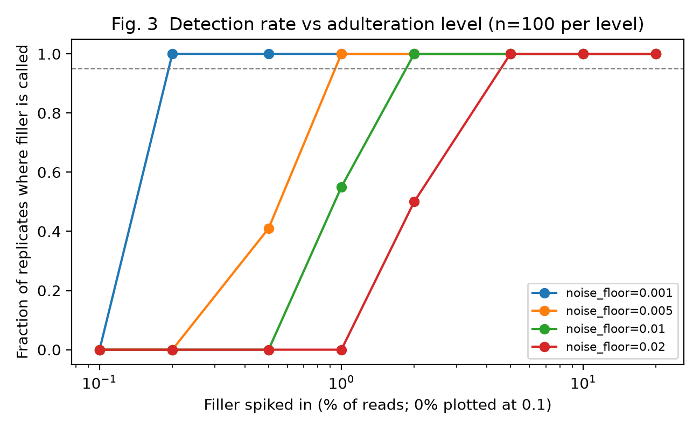

# 🔍 DNA Detective

**Is that turmeric really turmeric?** An open, reproducible workflow that uses DNA metabarcoding (ITS2) to detect adulteration and substitution in spices and herbal products, with an explicit, tunable decision rule.

> **Status:** Decision logic validated on **simulated** data. Real sequencing execution is **blocked and unvalidated**. Candidate ENA metadata have been retrieved; see [run log](docs/RUNLOG.md). See [MANUSCRIPT.md](MANUSCRIPT.md) for the full journal-style write-up, results and limitations.

## What it does
```
raw reads → DADA2 → BLAST vs ITS2 reference → species table → verdict (AUTHENTIC / ADULTERATED / SUBSTITUTED)
```

## Quick start (runs in seconds, no sequencing data needed)
```bash
python3 -m venv .venv
.venv/bin/pip install -r requirements-lock.txt
make demo
```
This simulates 30 spice samples plus a dilution series and regenerates every table and figure in `results/simulated/`.

## Key finding (simulation)
The noise floor sets your limit of detection: at ≥95% detection, a 0.1% floor catches 0.2% filler, a 1% floor needs ~2%, and a 2% floor needs ~5%.



## Repo layout
| Path | Purpose |
|---|---|
| `workflow/` | Real-data steps: SRA download, DADA2, BLAST (templates, untested) |
| `src/asv_to_species.py` | ASV counts + BLAST hits → species table |
| `src/authenticate.py` | Rule-based verdict classifier (CLI + importable) |
| `src/simulate_data.py`, `src/lod_experiment.py` | Simulations |
| `src/evaluate.py`, `src/plot_results.py` | Metrics and figures |
| `results/simulated/` | Generated tables and figures |
| `MANUSCRIPT.md` | Full write-up |
| `CODEX_PROMPT.md`, `AGENTS.md` | Prompt and rules for completing the real-data step with Codex |

## Use on your own species table
```bash
python src/authenticate.py --table my_species_table.csv --manifest my_manifest.csv --out verdicts.csv \
  --noise-floor 0.01 --adulterant-threshold 0.05
```
`species_table.csv`: `sample,species,reads` · `manifest.csv`: `sample,product,label_species`

## Roadmap
- [ ] Run on public SRA/BOLD spice and herbal datasets
- [ ] Mock-mixture calibration of read fraction vs true mass fraction
- [ ] Negative-control-based noise estimation
- [ ] Streamlit dashboard
- [ ] Cosmetic botanicals and endangered-species checks

## Citation
If you use this, please cite the repository (see `MANUSCRIPT.md`). Licence: MIT.

## Real-data status and next steps

`make real` runs a preflight and currently fails intentionally: sequencing executables, approved runs, verified labels, primer handling and a curated reference are missing. No real-data biological results are included. See [reference plan](docs/REFERENCE.md) and [candidate provenance](data/real/manifest_sources.csv).

To continue, install Conda separately, run `conda env create -f environment.yml`, and activate `dna-detective`. Verify the candidates against their source paper and run metadata; populate `data/real/accessions.txt` and `manifest.csv`. Prepare primer-free paired FASTQ input or add study-specific trimming, documenting it in `data/real/PRIMERS_VERIFIED.md`. Build and audit `its2_reference.fasta`, then run `make real PYTHON=python`. Marker mixing must be resolved before DADA2. R and BLAST stages remain UNTESTED.

`make test` checks missing-evidence handling and ASV identifier mapping. `INCONCLUSIVE` is returned for missing usable data or retained Unassigned reads. Species-level BLAST ambiguity and database completeness still need validation; these verdicts are research outputs.

## Optional GitHub publication

The project is committed locally. Public publication was mentioned only inside the attached brief and was not performed. When ready, from this directory:

```bash
gh auth login
gh repo create dna-detective --public --source=. --remote=origin --push
```
