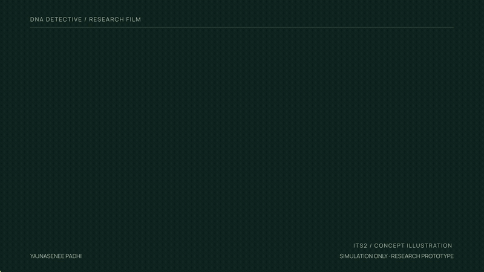
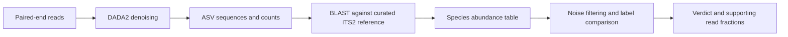
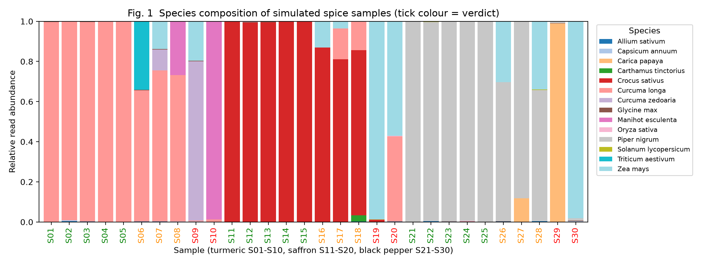

<div align="center">

# DNA Detective

### ITS2 metabarcoding for botanical product authentication

A reproducible research prototype for examining adulteration and substitution in spices and herbal products.

**By Yajnasenee Padhi**

**Python · DADA2 · BLAST+ · Reproducible simulations**

[Manuscript](MANUSCRIPT.md) · [Results](results/simulated/) · [Run log](docs/RUNLOG.md) · [Reference database plan](docs/REFERENCE.md)

</div>

---

## Project film

[](brag-output/brag.mp4)

[Watch the 24-second film](brag-output/brag.mp4) · [Poster](brag-output/brag.jpg) · [Video source and credits](brag-output/)

## Research question

**How does the choice of a noise threshold affect the detection of undeclared plant species?**

DNA metabarcoding can reveal plant DNA in complex botanical products. Translating those assignments into an authentication decision requires explicit assumptions about low-abundance signals, the declared ingredient, and uncertainty. DNA Detective makes that decision rule inspectable and measures its behaviour using reproducible simulations.

> **Evidence status:** The classifier has been evaluated on simulated data. No real sequencing dataset has been processed end to end. Public run metadata are archived, but marker suitability, product labels, primer handling and a curated reference remain unresolved. This repository does not establish accuracy on commercial products.

## Workflow



The sequencing stages are **UNTESTED on real data**. The simulation enters at the species-table stage, so it tests the decision logic rather than sequencing or taxonomic assignment accuracy.

## Methods

The planned sequencing workflow denoises paired reads into amplicon sequence variants (ASVs), then assigns each ASV using its highest-scoring BLAST hit. The current assignment thresholds are **97% identity** and **90% query coverage**. Reference completeness and equally strong matches still require validation.

The classifier removes taxa below a configurable noise floor and renormalises the retained read counts. With default thresholds, the declared species' retained fraction determines the result:

| Condition | Output |
| :--- | :--- |
| No usable reads, no retained taxa, or retained unassigned reads | `INCONCLUSIVE` |
| Declared species fraction below 5% | `SUBSTITUTED` |
| Declared species fraction at least 95% | `AUTHENTIC` |
| Otherwise | `ADULTERATED` |

These are operational research categories. Read fractions are not ingredient mass fractions, and a classifier result alone does not establish deliberate adulteration.

## Simulation results

### Classification panel

The seeded panel contains **30 simulated samples** representing turmeric, saffron and black pepper. All panel predictions match the generated ground truth: **15 authentic, 9 adulterated and 6 substituted**. This deliberately separated panel tests implementation behaviour; it is not a real-world accuracy estimate.



*Figure 1. Simulated species composition. Sample-label colours indicate the classifier verdict.*

[Verdicts and ground truth](results/simulated/verdicts.csv) · [Confusion matrix](results/simulated/confusion_matrix.csv) · [Threshold sweep](results/simulated/threshold_sweep.csv)

### Sensitivity to the noise floor

A separate simulation adds maize reads to turmeric at eight spike levels, with 100 replicates per level. The minimum **tested** spike level reaching at least 95% detection changes with the noise floor:

| Noise floor | Minimum tested filler fraction with ≥95% detection |
| ---: | ---: |
| 0.1% | 0.2% |
| 0.5% | 1% |
| 1% | 2% |
| 2% | 5% |


*Figure 2. Detection of the specified filler taxon in simulation. These fractions describe reads, not biomass. Detection of a filler taxon is distinct from the final authenticity verdict.*

Values are reproducible from [the detection-rate table](results/simulated/lod_detection_rate.csv). Background noise in this experiment excludes the filler itself, so its false-positive behaviour does not represent contamination with that taxon.

## Reproduce the analysis

Requires Python 3.11 and GNU Make or a compatible `make`. Run from the repository root:

```bash
python3 -m venv .venv
.venv/bin/pip install -r requirements-lock.txt
make demo
make test
```

`make demo` regenerates the seeded data, tables and figures under `data/` and `results/simulated/`. `make test` checks missing-evidence handling and ASV identifier mapping, including reordered count rows and empty BLAST results. The Makefile automatically uses the local virtual environment when present.

### Analyse an existing species table

```bash
.venv/bin/python src/authenticate.py \
  --table species_table.csv \
  --manifest manifest.csv \
  --out verdicts.csv \
  --noise-floor 0.01 \
  --adulterant-threshold 0.05
```

| Input | Required CSV columns |
| :--- | :--- |
| Species table | `sample,species,reads` |
| Product manifest | `sample,product,label_species` |

Use matching sample identifiers and consistent species names in both files. Outputs include the declared species fraction, verdict, other retained taxa and total read count.

## Public-data case study: current status

Candidate paired-end amplicon runs were retrieved from ENA for study **PRJNA1279389**. Their archive identifiers and layouts were verified; their suitability for an ITS2-only product authentication analysis was not. Candidate records are not approved inputs.

- [Archived study metadata](data/real/ena_study.tsv)
- [Candidate provenance and verification gaps](data/real/manifest_sources.csv)
- [Real-workflow preflight output](docs/real-preflight.log)

`make real` currently stops at preflight because required sequencing software and verified biological inputs are missing. There are no real-data verdicts or composition figures in this repository.

To complete this stage:

1. Install Conda and create the sequencing environment with `conda env create -f environment.yml`; activate `dna-detective`.
2. Verify source publications, run-level markers, product labels and primer sequences. Resolve any mixed-marker libraries before denoising.
3. Populate `data/real/accessions.txt` and `data/real/manifest.csv` with approved inputs.
4. Implement and validate study-specific primer removal, or verify primer-free reads; document the evidence in `data/real/PRIMERS_VERIFIED.md`.
5. Build and audit `data/real/its2_reference.fasta` following [the reference plan](docs/REFERENCE.md).
6. Run `make real PYTHON=python`, inspect quality-control evidence, and report successes and failures.

The target provides orchestration; it is not yet a validated end-to-end analysis.

## Repository structure

```text
dna-detective/
├── data/                 Seeded simulation inputs and public-run metadata
├── src/                  Classification, simulations, conversion and plotting
├── workflow/             SRA download, DADA2 and BLAST templates
├── tests/                Focused synthetic regression tests
├── results/
│   ├── simulated/        Reproducible simulation tables and figures
│   └── real/             Status only; no biological results yet
├── docs/                 Provenance, execution logs and reference plan
├── MANUSCRIPT.md          Research write-up and limitations
├── environment.yml       Proposed sequencing environment
├── requirements-lock.txt Python dependency versions used locally
└── Makefile              demo, test and real entry points
```

## Limitations and next experiments

PCR bias, ITS copy-number variation, DNA degradation and reference misannotation can all affect inferred composition. Closely related taxa may share barcode sequences. The current classifier assumes one declared species per sample and is not designed to authenticate multi-ingredient formulations without adaptation.

The next validation steps are negative controls, known mock mixtures, replicate support, ambiguity-aware taxonomic assignment, and an independently verified public-data case study. Numerical results in the present repository concern simulations only.

## Research documentation and licence

The [manuscript](MANUSCRIPT.md) contains the experimental design and discussion. The [run log](docs/RUNLOG.md) distinguishes executed steps from untested code. Inherited bibliographic entries remain marked for verification; no publication or DOI is claimed for this project.

Released under the [MIT licence](LICENSE).
